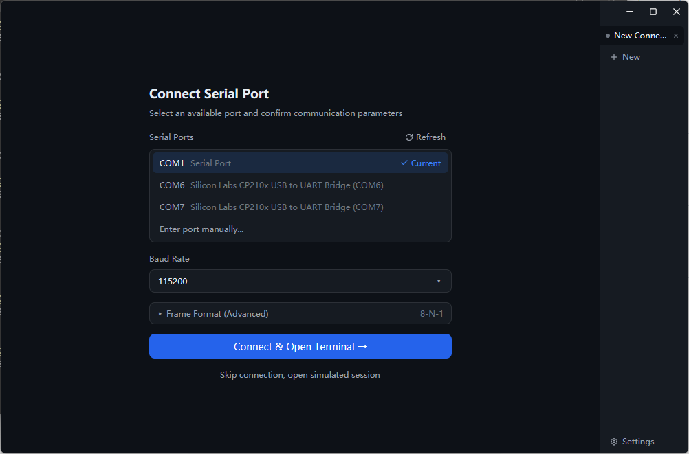
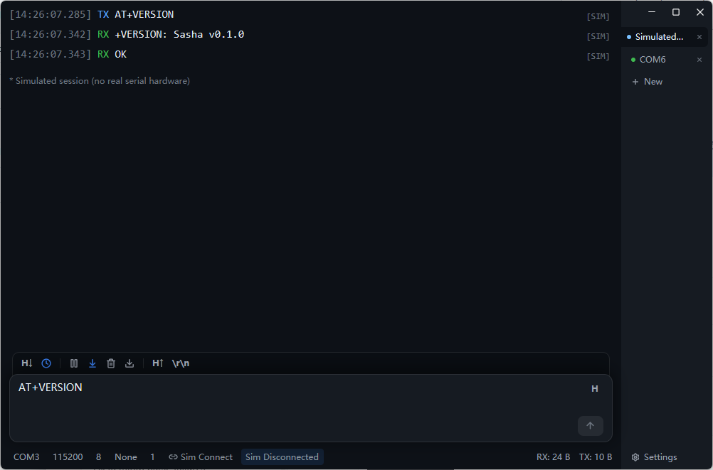

<p align="center">
  
</p>

<h1 align="center">Sasha</h1>
<p align="center">English · <a href="README.zh-CN.md">简体中文</a></p>

Sasha is a Rust desktop application built with GPUI. It brings serial connections,
text and HEX inspection, and multiple independent sessions into a compact dark
interface.

## Preview

<table>
  <tr>
    <th width="50%">Connect your device</th>
    <th width="50%">Inspect and send data</th>
  </tr>
  <tr>
    <td><a href="docs/images/sasha-connection.png"></a></td>
    <td><a href="docs/images/sasha-terminal.png"></a></td>
  </tr>
</table>

Click either screenshot to view it at full size. The terminal preview shows a
simulated session.

The project is under active development. Windows is the current development and
validation platform; macOS and Linux builds have not been verified.

## Features

- **Multiple sessions** — open, switch, and close connections from the right sidebar.
- **Serial configuration** — discover available ports or enter one manually; configure
  baud rate, data bits, parity, and stop bits.
- **Receive inspection** — switch between text and HEX, toggle timestamps, pause
  display updates, control auto-scroll, select and copy text, and export visible logs.
- **Flexible sending** — send UTF-8 text or HEX bytes, with optional CRLF or LF
  endings for text messages. Input HEX display and HEX sending are separate controls.
- **Connection feedback** — monitor connection state and RX/TX byte counters.
- **Native editing** — a blinking block caret in the send field, with normal text
  selection and editing behavior.
- **Preferences** — switch between English and Simplified Chinese and adjust log
  font size. Global preferences are stored locally in TOML.

## Build and run

You need Git, Rust and Cargo with support for the Rust 2024 edition, and the native
build tools required by your Rust target. On Windows, use the MSVC toolchain with
Visual Studio C++ Build Tools and a Windows SDK installed.

```powershell
git clone https://github.com/yanggx98/Sasha.git
cd Sasha
cargo run --locked
```

To create an optimized executable:

```powershell
cargo build --release --locked
```

The Windows executable is written to `target/release/sasha.exe`.
The first build downloads dependencies; subsequent builds can run offline once
those dependencies are cached. Keep the `vendor/` directory when copying the source.

## Getting started

1. Select a detected serial port, or enter its name manually.
2. Set the communication parameters to match your device, then connect.
3. Inspect incoming data in the log area and enter outgoing data in the send field.
4. Use the arrow button to send. Create additional sessions from the sidebar.

To explore without a device, choose **Enter simulated session** on the connection
page. Simulated data and connection states are labeled separately from real ones.

### Text and HEX controls

The three HEX controls are independent:

| Control | What it changes |
| --- | --- |
| Receive HEX display | How log payloads are displayed. |
| Send-field `H` | How the draft is displayed and converted between text and HEX. |
| HEX send mode in the receive toolbar | Whether sending encodes the draft as UTF-8 text or parses it as HEX bytes. |

HEX input uses space-separated byte pairs, such as `0A FF 1B`.
Text mode can append no line ending, CRLF (`\r\n`), or LF (`\n`); HEX mode sends the
parsed bytes without appending a text line ending. Converting HEX back to text
requires valid UTF-8.

### Keyboard shortcuts

| Shortcut | Action |
| --- | --- |
| `Ctrl+T` | New session |
| `Ctrl+W` | Close the current session |
| `Ctrl+Tab` / `Ctrl+Shift+Tab` | Next / previous session |
| `Ctrl+1` … `Ctrl+8` | Switch to the corresponding session |
| `Ctrl+9` | Switch to the last session |
| `Ctrl+C` | Copy selected text from the focused editor or log area |
| `Enter` / `Esc` in a parameter picker | Confirm / cancel the parameter change |

## Preferences

Open **Settings** from the sidebar. Preferences are saved to `config.toml` beside
the executable. The settings page shows the resolved configuration path.

```toml
version = 1
locale = "en-US"
log_font_size = 14
```

Supported locale values are `en-US` and `zh-CN`; the default is `zh-CN`.
The log font size presets are 12, 13, 14, and 15 logical pixels.
Session drafts and connection states are not restored from this file.
If a malformed TOML file is detected, Sasha attempts to back it up as
`config.toml.bak` and falls back to defaults.

## Current boundaries

- The visible log history retains the most recent **2,000 entries**. Export saves
  the currently visible history in its current display format, not a full raw capture.
- Pausing freezes log display, not the serial connection. Buffered entries are
  added when display resumes.
- Real serial connections support one or two stop bits. The 1.5-stop-bit option
  is rejected by the current backend.
- A simulated session is a UI preview, not a hardware loopback test.

## Development

```powershell
cargo check --locked
cargo test --locked
```

Tests cover data formatting, send validation, session behavior, configuration, and
native caret geometry. Hardware communication and desktop interaction also need
manual testing on the target system.

```text
src/
  main.rs          Application startup
  i18n.rs          English and Simplified Chinese strings
  serial.rs        Port discovery and serial I/O
  model/           Sessions, logs, serial parameters, and preferences
  ui/              Workspace, connection page, send field, and settings
assets/icons/      Application artwork
vendor/            Local GPUI dependency and patch notes
```

Sasha patches `gpui-base` 0.9.1 locally to support per-input native caret styling
and hiding the send-field hint while focused. The original caret lifecycle is
retained. See [the patch documentation](vendor/README.md) for provenance, licensing,
and upgrade guidance.

## Acknowledgements

Sasha is built on the work of these open-source projects:

- **[GPUI-KIT](https://github.com/longbridge/gpui-kit)** — the UI toolkit and
  component library used by Sasha.
- **[GPUI](https://github.com/zed-industries/zed/tree/main/crates/gpui)** — Zed's
  GPU-accelerated UI framework, maintained in the
  [Zed repository](https://github.com/zed-industries/zed).

AI tools used during the development of Sasha include **DeepSeek, Grok, ChatGPT,
and Gemini**.

## Feedback

Report bugs and suggest improvements through
[GitHub Issues](https://github.com/yanggx98/Sasha/issues). Include your Windows
version, application revision, reproduction steps, and relevant serial parameters.
For UI issues, a screenshot and display scaling setting are helpful.

## License

Sasha is licensed under the **GNU General Public License v3.0 only
(GPL-3.0-only)**. See [LICENSE](LICENSE) for the full terms.

Vendored GPUI code retains its [Apache-2.0 license](vendor/gpui-base/LICENSE-APACHE);
other dependencies retain their respective licenses.
