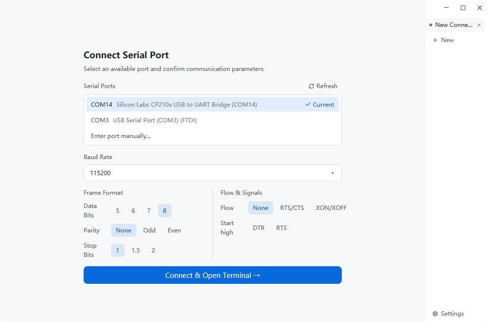
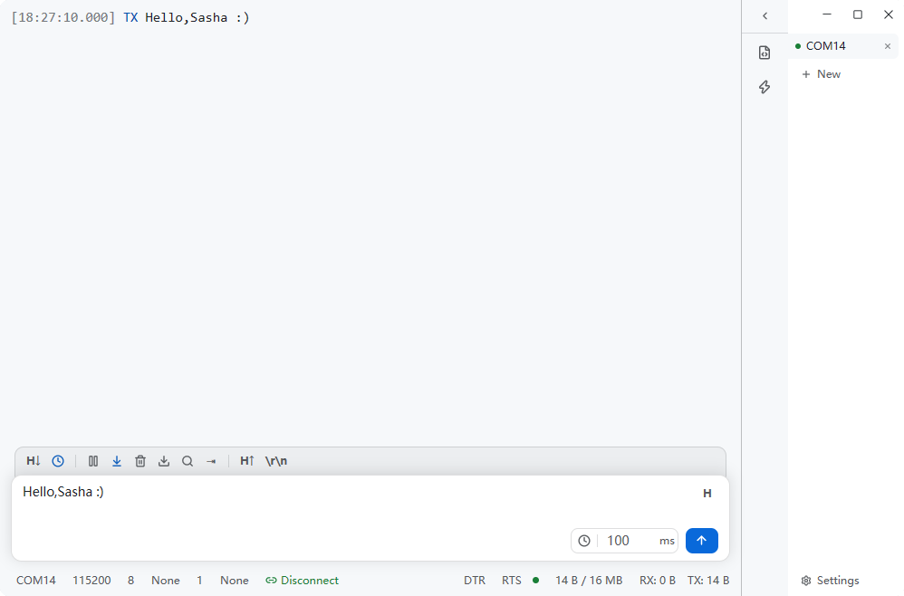

<p align="center">
  
</p>

<h1 align="center">Sasha</h1>
<p align="center"><a href="README.md">English</a> · 简体中文</p>

<p align="center">
  <a href="LICENSE"></a>
  
  
</p>

Sasha 是一款使用 Rust 和 GPUI 编写的开源桌面串口调试工具，将多会话管理、文本与 HEX 查看、快捷发送与定时发送、Lua 脚本、实时日志流输出和可自定义主题整合在紧凑的原生界面中。

## 界面预览

<table>
  <tr>
    <th width="50%">连接设备</th>
    <th width="50%">查看与发送数据</th>
  </tr>
  <tr>
    <td><a href="docs/images/sasha-connection.png"></a></td>
    <td><a href="docs/images/sasha-terminal.png"></a></td>
  </tr>
</table>

点击截图可查看原图。

项目正在持续开发。目前以 Windows 为开发和验证平台，尚未验证 macOS 与 Linux 构建。

## 功能

- **多会话管理**：多个独立连接，通过右侧栏切换。
- **完整串口配置**：端口发现、波特率、帧格式、流控及 DTR/RTS。
- **接收查看**：文本/HEX、时间戳、搜索、暂停、复制、导出。
- **灵活发送**：UTF-8 文本或 HEX 字节，另有快捷发送与定时发送。
- **Lua 脚本**：内置 Lua 5.4，自动化串口流程，无需另行安装。
- **实时流输出**：把会话的全部 RX/TX 日志实时追加到文件。
- **主题**：深色/浅色，支持热更新的自定义 TOML 主题和可选背景图。
- **版本更新**：检查 GitHub Releases，可在应用内安装新版本。
- **中英文界面**。

## 快速开始

从源码构建（需要 Git 和支持 Rust 2024 edition 的 Rust；Windows 使用 MSVC 工具链，并安装 Visual Studio C++ Build Tools 和 Windows SDK）：

```powershell
git clone https://github.com/yanggx98/Sasha.git
cd Sasha
cargo run --locked            # 或：cargo build --release --locked  ->  target/release/sasha.exe
```

1. 选择检测到的串口，或手动输入端口名称。
2. 设置与设备一致的通信参数，然后连接。
3. 在日志区查看接收数据，在发送框输入待发送内容。
4. 点击箭头按钮发送，通过右侧栏创建更多会话。

### 快捷键

| 快捷键 | 功能 |
| --- | --- |
| `Ctrl+T` / `Ctrl+W` | 新建 / 关闭会话 |
| `Ctrl+Tab` / `Ctrl+Shift+Tab` | 下一个 / 上一个会话 |
| `Ctrl+1` … `Ctrl+8`、`Ctrl+9` | 切换到第 1–8 个 / 最后一个会话 |
| `Alt+1` … `Alt+9` | 发送对应的快捷指令 |
| `Ctrl+C` | 复制选中文字 |

## 文档

- [使用指南](docs/usage.zh-CN.md)：HEX 控制、实时流输出、快捷发送、定时发送、版本更新及 `config.toml` 偏好设置。
- [主题](docs/themes.zh-CN.md)：内置与自定义主题。
- [Lua 脚本 API](docs/lua-scripting-api.md)
- [参与贡献](CONTRIBUTING.md)（英文）

## 当前边界

- 可见日志最多保留最近 **2,000 条记录**。导出保存当前可见历史及其显示格式，并非完整的原始数据抓取。
- 暂停只冻结日志显示，不会停止串口连接。
- 真实串口连接支持 1 或 2 个停止位，后端会拒绝 1.5 个停止位。

## 致谢

基于 [GPUI-KIT](https://github.com/longbridge/gpui-kit) 和 [GPUI](https://github.com/zed-industries/zed/tree/main/crates/gpui) 构建。开发过程中使用的 AI 工具有：DeepSeek、Grok、ChatGPT、Gemini、Claude。

## 参与贡献与反馈

欢迎提交 Pull Request，请先阅读 [CONTRIBUTING.md](CONTRIBUTING.md)（英文）。问题请通过 [GitHub Issues](https://github.com/yanggx98/Sasha/issues) 反馈，并提供 Windows 版本、应用代码版本、复现步骤及相关串口参数（界面问题建议附截图和显示缩放比例）。

## 许可证

Sasha 采用 **GNU 通用公共许可证第 3 版（仅此版本，GPL-3.0-only）**。完整条款见 [LICENSE](LICENSE)。

依赖项（包括 GPUI，Apache-2.0）遵循各自许可证。
